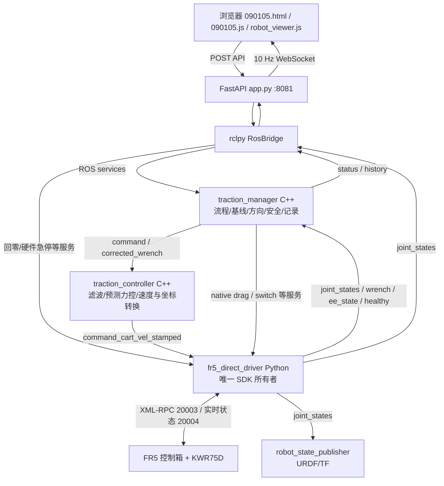

# FR5 工作站接手总览

核对日期：2026-10-26（Asia/Shanghai）。源码基线：`feat/multi-mode-traction` / `881117c007c1b77e722c9e5879975f7bf3977d4b`。本资料基于代码阅读和本机离线验证；本次没有连接或操纵机器人。

2026-10-27 后续修改：省力拖拽启动确认窗口、启动回复丢失的安全收尾和诊断已修复，详见 [硬件手册](HARDWARE.md) 4.3 与 [本机与验证](MACHINE_AND_VALIDATION.md) 第6节；30项驱动离线测试通过，尚未实机复验。早前的提前限位功能需求已取消，未实现。

2026-10-27最新修正：依据新两份日志及用户确认，搜索改为0.30m/5s平滑轨迹（理论峰112.5mm/s），短暂尖峰消失可在原预算内继续；目标远场恢复20mm/s，正式SDK下发改为有界绝对位姿轨迹，目标领先量限幅5mm（短时不故障，持续无进展才停止）。正式overlay构建及针对性离线检查通过，没有操作真机；完整实机效果仍待确认。最新追加：控制向目标中心收敛，实际力进入目标±2.5N连续2秒停止、启动免登录，详见本机与验证第12节；第9–11节保留为前版记录。

## 从这里开始

| 任务 | 阅读入口 | 负责的内容 |
| --- | --- | --- |
| 新机器接手、确认当前可运行程度 | [本机与验证](MACHINE_AND_VALIDATION.md) | WSL、环境、依赖、网络现状、已跑检查及未验证项 |
| 本电脑带到现场，插线后启动 | [现场速查](FIELD_READINESS.md) | 本机软件准备结果、Windows 有线网口、现场启动命令 |
| 安装、启动、停止、现场演示 | [运行手册](RUNBOOK.md) | 新部署、现有环境、source/build、运行步骤、旧链路边界 |
| 改恒力、位置牵引、方向跟随或状态机 | [控制系统](CONTROL.md) | 算法、状态、ROS 消息、控制参数、安全、离线测试 |
| 接线、IP、SDK、传感器、急停、拖动和回零 | [硬件手册](HARDWARE.md) | 驱动行为、通信拓扑、坐标和单位、排障顺序 |
| 改页面、按钮、API、曲线、模型、历史导出 | [网页与数据](WEB_AND_DATA.md) | 前后端职责、接口映射、权限现状、日志和持久化 |

新会话默认先读取项目根的 [AGENTS.md](../../AGENTS.md)。这组文档和代码一起保存在仓库，换机器或丢失聊天记录后仍可使用。机器审计是有日期的快照，环境变化后需重查。

## 当前实际系统

`/controller_manager/*` 是兼容命名空间：当前 driver 自己发布/提供这些接口，不能据此判断运行了标准 ros2_control controller_manager。主 launch 不启动 MoveGroup、相机、夹爪控制或旧硬件插件。三维机械臂是实时关节角展示，不能表示场景碰撞检查已启用。

## 目录与职责

| 路径 | 职责与修改入口 |
| --- | --- |
| `app.py` | HTTP/WS、参数持久化、页面操作日志、ROS 服务编排、导出、关闭进程 |
| `backend/ros_bridge.py` | 唯一网页 rclpy 节点、订阅状态、快照锁、服务异步等待与超时 |
| `static/090105.html` | 原生 HTML/CSS 布局、DOM、弹窗、脚本入口；没有前端打包工具 |
| `static/090105.js` | 本地操作、按钮状态、API 调用、目标力调节、60 秒曲线、历史与心跳 |
| `static/robot_viewer.js` / `static/model` | Three.js/STL 关节模型、牵引方向箭头；第三方 JS 随项目本地提供 |
| `ros2_overlay/src/fr_traction` | 当前业务主包：消息、服务、核心算法、ROS 节点和直连驱动 |
| `ros2_overlay/src/fairino_msgs` | 兼容的 `PoseTwist`、状态/旧远程命令接口定义 |
| `ros2_overlay/src/fairino5_v6_moveit2_config` | 当前使用 URDF/xacro；其余 MoveIt/Gazebo/旧控制 launch 是另一条运行路径 |
| `ros2_overlay/src/fr_controllers` | 旧 ros2_control 笛卡尔速度插件；当前正式启动不加载它 |
| `ros2_overlay/reference` | 旧 fairino_hardware 参考源码和有限值检查，不是当前 driver 的实现 |
| `ros2_overlay/src/fairino_description` / `vendor` | 安装脚本获取的外部描述和 SDK，Git 忽略；换机器需恢复 |
| `scripts` / `run_workstation.sh` | 准备环境、两个终端启动、桌面监督进程、预检、Python 检查 |
| `tests` / `fr_traction/test` | 网页/API 合约、driver 假 SDK、核心 C++ 回归 |
| `debug/traction_sessions` | 默认真实记录和操作日志，Git 忽略；重要会话须单独备份 |
| `config/workstation.json` / `static/config.json` | 遗留配置/模型描述；当前主链路没有加载，不是力控调参入口 |
| 上一级 `platform_a/platform_b/state_service/force_tension_demo` 等 | 同仓库旧应用；不属于当前工作站启动依赖，不能同时占用真实 SDK |

## 当前三模式（2026-10-27）

| 模式 | 使用方式 |
| --- | --- |
| 省力拖拽 2，默认 | 自动校准完成后点击开始；FR5内部EndForceDragControl |
| 目标牵引 1 | ≥3N时每2秒更新候选方向，开始锁向直到结束；无方向自动工具Z−平滑搜索（规划5秒30cm，峰112.5mm/s），3N即停，静止持续受力后确认方向转目标；短暂尖峰可在原时限内继续；控制向目标中心逼近，实际力处于目标±2.5N连续2秒后保位 |
| 卸力 3 | 优先最近牵引方向，否则最新方向；可运行中一键交接，反向卸力至<5N停止 |

启动健康静止反馈后自动校准一次。结束、模式切换、恢复和网页重连保留基线；顶栏手动重新校准才重置。回零、设零、手动方向确认和公开恒力模式已取消。目标上限默认100N但设置可提高，取消工作站实际力超限故障；硬件原生保护保留。旧记录模式0仍表示历史恒力。

本次同时修改了ROS消息、manager/controller/driver与网页，必须重新构建并重启ROS和网页。新功能未执行真机运动验收；阅读本机与验证的最新追加记录，旧审计仅作历史。

## 问题出现时从哪一层开始

| 现象 | 先看 | 再看 |
| --- | --- | --- |
| 页面打不开 | 8081 监听、虚拟环境、uvicorn 日志 | `run_workstation.sh` 的 overlay source 与端口替换行为 |
| 页面能开但通信中断 | `/api/health`、`/api/state` 中两路 age/connected | bridge 消息导入、source 路径、ROS 域、driver/manager 话题频率 |
| 看见模型但不动/方向错 | `/joint_states`、浏览器资源/WS、viewer 变换 | 区分显示安装补偿、真实工具轴补偿、ServoCart 基坐标符号 |
| 力异常/漂移/准备被拒 | 松绳条件、传感器激活、原始和 corrected_wrench | manager 基线/姿态变化、参考系设置；不要带载反复校准 |
| 硬件连接失败 | WSL/Windows 物理网口 → 路由 → 20003/20004 → 重复 SDK 进程 | SDK revision、状态包新鲜度、参考系/模式和控制箱错误 |
| 目标不收敛/过冲 | session CSV 的 force/target/phase/rate/stiffness/velocity | `traction_math.cpp` 预测控制 → core → controller 符号 → driver |
| 方向不跟随或等待张紧 | `direction_track_state`、力模、候选分散度/计时 | `direction_correction.cpp` 与 manager 的方向子循环 |
| 结束、急停、回零行为不对 | 明确是哪一个 HTTP/ROS 服务 | manager 状态和 driver native/servo/return 交接及硬件状态 |
| 历史缺失/导出 404/400 | manager 数据目录、摘要 record_path、会话是否已 finalize | app 固定 SESSION_ROOT、主机数据迁移与文件是否被忽略 |

## 阅读覆盖和证据边界

此次接手覆盖工作站自有前后端源码、全部 ROS 控制核心/驱动与测试、消息服务、参数、启动/部署脚本、旧插件/参考实现和项目 Markdown 文档；第三方 Three.js/SDK 不逐行审计全部实现，核对了主链路用到的接口与导入、状态、RPC 行为。上级旧项目只确认边界，不声称完成其全部业务审计。

已执行验证详见 MACHINE_AND_VALIDATION。代码可运行、离线算法通过、实际机械臂现场验收是三个不同结论。本机目前未完成硬件连通性或三模式实机验收。

历史资料的旧频率、旧限力/行程、旧回零语义和实验结果不能直接当作当前配置。当前仍有未修复的状态/参数分支问题和部署工具局限，集中列于 CONTROL、RUNBOOK 和 MACHINE_AND_VALIDATION；后续工作流修改与验证以各文档2026-10-27当前说明及本机与验证最新追加节为准。
